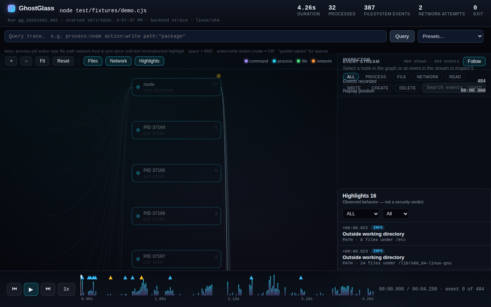
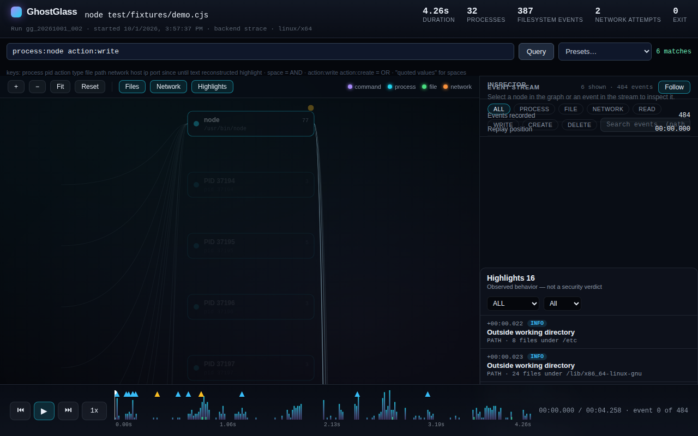
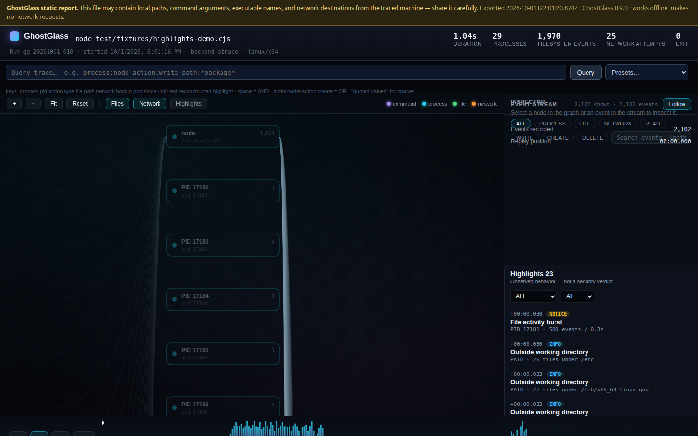
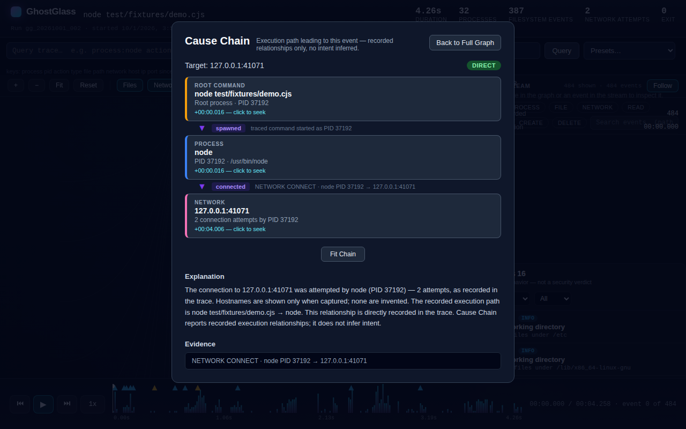
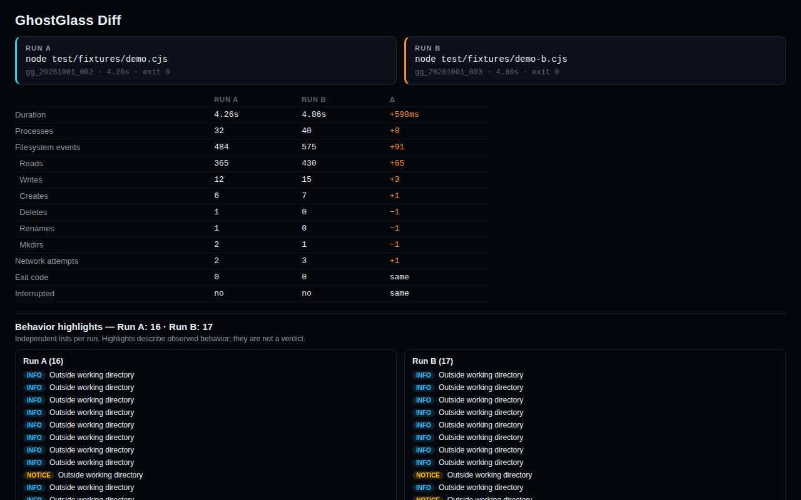
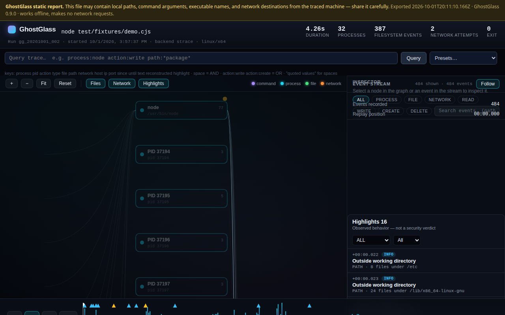

# GhostGlass

[](https://github.com/solhopie/ghostglass/actions/workflows/ci.yml)
[](LICENSE)
[](package.json)

**See what your commands are doing when you're not looking.**
GhostGlass is a local-first Linux execution tracer that records process, filesystem, and network activity and turns it into an interactive visual timeline.

```sh
ghostglass run -- npm install express
ghostglass open latest
```

```sh
ghostglass watch -- npm install express
```

GhostGlass runs your command under `strace`, normalizes every syscall into
structured events, and saves a replayable trace on your machine — no
accounts, no cloud, no telemetry, no AI. Open the trace in a local web
viewer to explore the process tree, every file touched, and every network
connection attempt on a scrubbable timeline. Or watch it happen live while
the command is still running.



```
Command
  ↓
GhostGlass Trace
  ↓
Processes + Files + Network
  ↓
Replay / Live View
  ↓
Query / Highlights / Cause Chain
  ↓
Diff / Export
```

## Features

**Trace**
See processes, files, and network activity for any command.

**Replay**
Scrub through an execution timeline in the local viewer.

**Live Glass**
Watch activity appear while a command is running.

**Diff**
Compare two runs side by side.

**Highlights**
Surface notable execution behavior — deterministic rules, no verdicts.

**Cause Chain**
Trace an event back through its recorded process ancestry.

**Query**
Search huge traces with deterministic structured filters.

**Export**
Generate offline, self-contained HTML reports.

---

## See GhostGlass in Action

The viewer: process/file/network graph, scrubbable timeline, virtualized
event stream, behavior highlights, and inspector — all local.


Filter any trace with the structured query engine — same syntax in the
viewer, Live Glass, and portable exports.



Behavior highlights describe observed patterns ("File activity burst",
"Outside working directory") — deterministic rules, never verdicts.



Ask what chain of execution caused an event. Every link cites the trace
event it came from; nothing is inferred.



Compare two runs: duration, processes, files, network, and highlights,
side by side.



Export a single HTML file that opens from `file://` with zero network
requests — the full viewer embedded, safe to attach to a bug report.



> A Live Glass screenshot (activity streaming mid-run) is not yet captured
> — see the remaining release tasks in `docs/PUBLISHING.md`. Live streaming
> itself is implemented and covered by tests; only the screenshot is
> pending a real-browser capture.

## Demo Walkthrough

The canonical demo uses the bundled fixture (safe, deterministic, no
network — it only touches files under `test/fixtures/` and cleans up
after itself):

```sh
ghostglass watch -- node test/fixtures/live-demo-long.cjs
```

While it streams, walk the full loop in the Live Glass viewer:

1. **Live activity** — watch processes, files, and network events appear
   as they happen.
2. **Behavior Highlight** — bursts and file churn surface in the
   highlights panel as the waves run.
3. **Query** — filter the stream live, e.g. `action:delete` or
   `process:node`.
4. **Inspector** — click any event to see its full detail.
5. **Cause Chain** — from the inspector, trace the event back through
   recorded process ancestry.
6. **Replay** — when the command exits, the view transitions to full
   replay; scrub the timeline.
7. **Export** — `ghostglass export latest -o ./demo.html` for a portable
   offline copy.

For a non-interactive demo that just records the trace and prints the
viewer command:

```sh
npm run demo
```

Or watch the long fixture stream live (opens the Live Glass viewer):

```sh
npm run demo:watch
```

## Quick Start

**Requirements:** Linux, Node.js 18+, `strace`, and a modern browser for the
visual viewer.

```sh
git clone https://github.com/solhopie/ghostglass.git
cd ghostglass
npm install
npm run build
```

Then trace the bundled demo fixture (deterministic, offline, no installs):

```sh
node dist/src/cli.js run -- node test/fixtures/demo.cjs
node dist/src/cli.js open latest
```

Or link the CLI onto your PATH:

```sh
npm link   # makes `ghostglass` available globally from this checkout
```

**npm:** `npm install -g ghostglass` will be available after the npm
release. It is not published yet — install from source until then.

Missing `strace`? GhostGlass tells you how to install it:

```sh
# Debian/Ubuntu
sudo apt install strace
# Fedora/RHEL
sudo dnf install strace
# Arch
sudo pacman -S strace
# Alpine
sudo apk add strace
```

Check yours with `strace --version`. If `strace` is missing when you run
`ghostglass run` or `ghostglass watch`, the CLI prints the install
instructions above instead of failing cryptically. `strace` needs no root
to trace your own processes.

## Commands

| Command | What it does |
|---|---|
| `ghostglass run -- <cmd>` | Trace a command, save the run |
| `ghostglass watch -- <cmd>` | Trace with a live streaming viewer |
| `ghostglass runs` | List saved traces |
| `ghostglass show <run-id>` | Print a saved trace summary |
| `ghostglass open <run-id>` | Replay a trace in the local viewer |
| `ghostglass diff <a> <b>` | Compare two traces side by side |
| `ghostglass highlights <run-id>` | List behavior highlights |
| `ghostglass why <run-id> --file <path>` | Cause chain for a target |
| `ghostglass query <run-id> [filters]` | Structured trace search |
| `ghostglass export <run-id>` | Self-contained HTML report |
| `ghostglass export-diff <a> <b>` | Self-contained HTML comparison |

`latest` works anywhere a run ID is expected; `diff` and `export-diff`
also accept `previous`. Exit codes are
preserved: GhostGlass exits with the traced command's code (or 128+signal
when interrupted). Ctrl+C forwards the signal, cleans up tracer processes,
and still saves the partial trace marked `interrupted`.

## Trace Query

One deterministic engine shared by the CLI, the saved viewer, Live Glass,
portable exports, and diff. Structured `key:value` filters — no AI, no
natural-language guessing.

```sh
ghostglass query latest --process node --action write --action create
ghostglass query latest --type network --port 443 --limit 20 --json
ghostglass query latest --since +0.1s --until +2s --order sequence
ghostglass query latest --reconstructed
```

In the viewer and Live Glass, the query bar uses the compact syntax
(`?q=` deep links share a filtered view):

```
process:node
action:write
process:node action:write
path:*package*
type:network port:443
reconstructed:true
highlight:outside-working-directory
```

**Semantics:** different fields are AND; a repeated field is OR
(`action:write action:create` matches writes or creates). Unknown fields,
bad PIDs/ports/times fail with a clear error instead of guessing.
GhostGlass does not evaluate regex, JavaScript, shell syntax, or SQL —
filters are parsed as structured `key:value` pairs only.

**Globs:** values support `*` (any run of characters, may cross `/`) and
`?` (exactly one character, never crosses `/`). `path:*package*` matches
any path containing `package`; `path:/tmp/???.log` matches three-letter
names only.

**Ordering:** results are in timestamp order by default (ties broken by
ingestion sequence). `--order sequence` (or `order:sequence`) replays
ingestion/emission order instead. The distinction matters for Run 8+
traces: `timestamp` is the underlying syscall/event time, while `sequence`
is GhostGlass's ingestion order. Reconstructed split syscalls carry the
syscall *start* timestamp but are *emitted* at resume time, so the two
orders can differ on reconstructed traces. Old traces derive stable
in-memory sequences from `events.jsonl` order and are never rewritten.

See [docs/trace-format.md](docs/trace-format.md) for the full event model.

## Behavior Highlights

`ghostglass highlights latest` surfaces notable patterns — seven
deterministic rules, no AI, no external lookups:

- `high-file-activity`, `high-process-activity`, `high-network-activity`,
  `high-delete-activity` — activity bursts over a short window
- `outside-working-directory` — files touched outside the run's cwd
- `create-then-execute` — a file is created/written, then executed
- `rapid-file-churn` — fast create/modify/delete cycling on the same paths

**Highlights are not security verdicts.** They describe observed behavior
("600 file writes in 2 seconds") without assessing intent, risk, or
safety. Thresholds are configurable in `.ghostglassrc.json`.

## Cause Chains

```sh
ghostglass why latest --file /tmp/work/data.txt
ghostglass why latest --network 127.0.0.1:5432
ghostglass why latest --pid 1234
ghostglass why latest --event evt-abc123
```

Every link cites the trace event it came from. Confidence is honest:
`DIRECT` (target event is in the trace), `STRUCTURAL` (linked through
recorded structure), or `INCOMPLETE` (part of the path wasn't captured —
missing links are labeled, never guessed). Cause chains describe what the
trace recorded, not why someone did it.

## Compare Runs

```sh
ghostglass diff latest previous
```

Processes match by executable + captured argv + parent executable (not by
PID, so equivalent runs match even when PIDs differ); files by path;
network endpoints by IP:port. Everything else is **shared**, **changed**,
**only in A**, or **only in B** — GhostGlass never invents a relationship
the trace doesn't support. Diffs are computed on demand and never
persisted.

## Export Portable Reports

```sh
ghostglass export latest -o ./trace.html
ghostglass export latest --format json
ghostglass export-diff previous latest -o ./comparison.html
```

A single self-contained HTML file: opens from `file://`, zero network
requests (CSP `connect-src 'none'`), the full viewer embedded. Redact
before sharing — the saved trace on disk is never touched:

```sh
ghostglass export latest --redact-home --redact-network --redact-args
```

## Privacy

GhostGlass is local-first by design:

- **No accounts.** No sign-up, no login, nothing to configure.
- **No cloud requirement.** Everything runs on your machine.
- **No telemetry.** Not even anonymous usage stats.
- **No AI.** Nothing is sent to any model or external service, ever.
- **Viewer binds to `127.0.0.1` by default** and serves only GhostGlass run data.
- **No automatic uploads.** Export is always explicit and local.

Traces are recordings of what your machine did. They may still contain
**file paths, command arguments, process names, and network destinations**
— treat them as sensitive. Redact portable exports before sharing where
appropriate (`--redact-home`, `--redact-cwd`, `--redact-network`,
`--redact-args`). Your full environment is never written into a trace:
`execve` lines record only the argument vector, never environment variable
values.

## Requirements

- **Linux** — tracing uses `strace -f`. macOS/Windows tracers do not exist yet.
- **Node.js 18+** — per `engines` in `package.json`. Developed and tested on Node 22/24.
- **`strace`** — check with `strace --version`; the CLI prints install instructions if it's missing.
- **A modern browser** — for the visual viewer (bundled, dependency-free frontend; no build step for the user).

## How It Works

```
command
   ↓
strace -f
   ↓
line assembly
   ↓
split-syscall reconstruction
   ↓
normalization
   ↓
events.jsonl
   ↓
indexes
 ├─ replay
 ├─ live SSE
 ├─ query
 ├─ highlights
 ├─ cause chain
 ├─ diff
 └─ export
```

The key design decision: **tracing backends produce one common event
format.** `TracerBackend` is a small interface (`checkAvailable()` +
`run()`); the parser, storage, summary, and CLI layers never see
backend-specific output.

Each run is stored locally under `.ghostglass/runs/<run-id>/`:
`metadata.json`, `events.jsonl`, `summary.json`, `highlights.json`, and the
raw `trace.log` for debugging. See [docs/architecture.md](docs/architecture.md)
and [docs/trace-format.md](docs/trace-format.md).

## Current Limitations

- **Linux only.** No macOS/Windows tracer yet.
- **strace overhead.** Typically 2–10x for syscall-heavy workloads; summary timings are wall-clock including overhead.
- **Deterministic split-syscall reconstruction only.** `<unfinished>` / `<... resumed>` pairs are rejoined when pairable by PID + syscall name; unresolved fragments are dropped and counted, never guessed.
- **Hostnames are not resolved.** Network events carry IP + port.
- **AF_UNIX sockets are skipped.** Local IPC (e.g. D-Bus) is not recorded.
- **Only successful syscalls become file/process events** (except `connect` attempts, recorded even when refused — the attempt is the signal).
- **Viewer graph shows the top 600 files by activity**; the full event list is always in the stream.
- **Timestamps** assume the trace does not cross a local-midnight boundary.
- **Real-browser Live Glass validation** is still manually pending in this build environment (streaming is implemented and unit-tested; the pending item is a human watching it update live).
- **Traces can contain sensitive local information.** See Privacy.
- **No cloud/team collaboration.** Local-first by design.

## Development

```sh
npm install       # install dependencies
npm run typecheck # tsc --noEmit (app + web)
npm run lint      # eslint
npm test          # build + full suite (unit + end-to-end)
npm run build     # compile to dist/
npm run demo      # trace the bundled demo fixture, print the viewer command
```

Linux + `strace` are required for the tracing integration tests. Parser,
storage, summary, and viewer tests run without strace. Tests use the
Node.js built-in test runner and strict TypeScript. See
[CONTRIBUTING.md](CONTRIBUTING.md).

## License

MIT — see [LICENSE](LICENSE).
