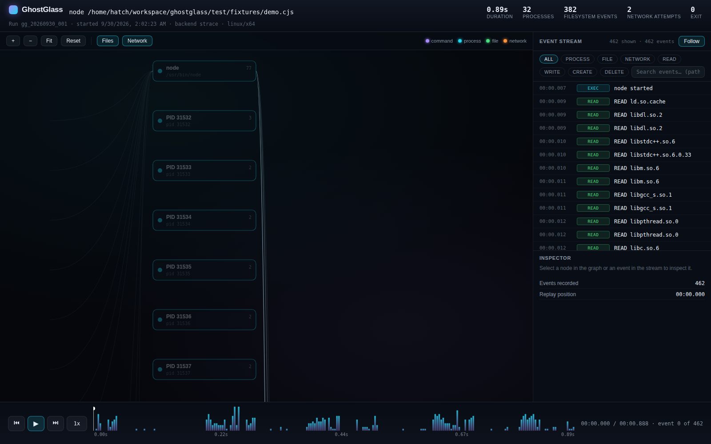
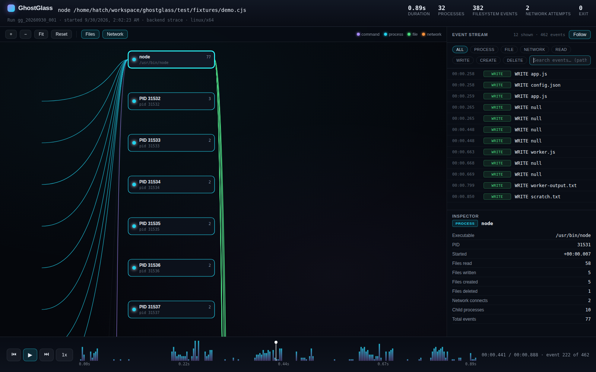

# GhostGlass

**See what your commands are doing when you're not looking.**

GhostGlass is a local system activity recorder and visual execution replay
tool for Linux commands.

```sh
ghostglass run -- npm install express
ghostglass open latest
```

```
Command
   ↓
Processes
   ↓
Files + Network
   ↓
Interactive Replay
```

GhostGlass runs your command under observation and shows you exactly what it
did: which processes it spawned, which files it read, wrote, created, and
deleted, and which network connections it attempted — all saved as a
replayable trace you own, on your machine.



> **Early release.** GhostGlass is Linux-first right now (it traces with
> `strace`). The tracing engine, normalized event format, local run storage,
> and the visual replay viewer are solid.

---

## What GhostGlass Does

- **Records** what a command actually does at the system-call level:
  processes started and their parent/child relationships, file reads,
  writes, creates, deletes, renames, and outbound network connection
  attempts (destination IP + port).
- **Stores** each run locally as structured data: `metadata.json`,
  `events.jsonl` (normalized events in chronological order),
  `summary.json`, and the raw `trace.log` for debugging.
- **Replays** runs in a local web viewer: an interactive process/file/
  network graph, a scrubbable timeline, and a searchable event stream —
  with no accounts, no cloud, and no telemetry.

It is built for developers who want ground truth about a command:
auditing an install script before trusting it, understanding what a build
touches, or debugging a process that misbehaves when nobody is watching.

## Quick Start

Requirements: **Linux**, **Node.js 18+**, and **`strace`**.

```sh
git clone https://github.com/<your-username>/ghostglass.git
cd ghostglass
npm install
npm run build
npm link        # makes `ghostglass` available on your PATH
```

(`<your-username>` is a placeholder — replace it with the actual GitHub
user or organization when the repository is published.)

Or run it without installing:

```sh
node dist/src/cli.js run -- npm install express
```

Missing `strace`? GhostGlass tells you how to install it:

```sh
# Debian/Ubuntu
sudo apt install strace
# Fedora/RHEL
sudo dnf install strace
# Arch
sudo pacman -S strace
# Alpine
sudo apk add strace
```

No accounts, no tokens, no cloud services, no AI. `strace` needs no root
to trace your own processes.

## Visual Replay

```sh
ghostglass open latest
```

opens the trace in a local, dependency-free web viewer. The server binds to
`127.0.0.1` only — your traces never leave the machine.

- **Process/file/network graph** — one node per process, file, and remote
  endpoint; edges for spawns, file access, and connections. Pan, zoom, drag
  nodes, fit/reset the view, and toggle file/network layers.
- **Replay with seeking** — play/pause at 1x/2x/4x, jump to start/end, and
  scrub the timeline forward *and* backward; the graph lights up nodes as
  their events are reached.
- **Virtualized event stream** — thousands of events stay smooth; filter by
  process/file/network, by action (read/write/create/delete), and by
  free-text search over paths, PIDs, IPs, and commands.
- **Inspectors** — click any graph node or event row for details: PIDs and
  parent PIDs, executables, file access counts, endpoints, timestamps.



- **Run picker** — `ghostglass open` with no run ID lists every saved trace;
  interrupted (partial) traces are badged.

```sh
ghostglass open <run-id> --no-browser   # print the URL, don't launch a browser
ghostglass open latest --port 8080      # listen on a different local port
```

The API only serves GhostGlass run data, and every trace string is rendered
as inert text — hostile filenames or command lines in a trace cannot inject
markup or scripts.

## Live Glass

```sh
ghostglass watch -- npm run dev
```

watches what your command is doing *while it is doing it*. GhostGlass traces
the command with strace exactly as `ghostglass run` does, but streams the
events to a live view in your browser as they happen — the graph grows, the
event stream scrolls, and the counters tick up in real time.

- **Live graph + stream** — same process/file/network graph and virtualized
  event stream as replay, fed incrementally over server-sent events.
- **Follow mode** — the stream auto-scrolls while you watch; scroll up to
  pause and inspect, and a "follow live" control jumps back to the head.
- **Live inspector** — click a running process or a fresh event to inspect
  it mid-flight.
- **Reconnects cleanly** — refresh the page or drop the connection and the
  viewer replays everything you missed with no duplicates, then resumes
  live. When the command exits, the view transitions to the full replay
  without a reload.
- **Completion is a normal trace** — the finished run is saved in the same
  format as `ghostglass run`, so `open`, `diff`, and `export` all work on
  it. If the viewer fails or you close the browser, tracing continues and
  the trace is still saved.

```sh
ghostglass watch --no-browser -- npm run dev   # trace without opening a browser
ghostglass watch --port 8080 -- npm run dev    # live viewer on another local port
```

The live server binds to `127.0.0.1` only, like `ghostglass open`. Exit
codes are preserved (including Ctrl+C as 130 with a partial trace saved),
and interrupting the command never leaves tracer processes behind.

```text
ghostglass watch -- <command>
          ↓
      Live Glass
          ↓
      Saved Run
       ↙  ↓  ↘
   Replay Diff Export
```

A finished live run is a normal GhostGlass run: replay it, diff it
against another run, or export a portable report — no extra steps.

## Behavior Highlights

GhostGlass automatically surfaces notable behavior patterns from your trace
— no AI, no external lookups, no judgment. Just deterministic, rule-based
observations about what the trace actually contains.

```sh
ghostglass highlights latest
```

**What it detects:**
- **High file activity** — 500+ filesystem events by one process in 3 seconds
- **High process activity** — 15+ child spawns in 2 seconds
- **High network activity** — 20+ connections in 5 seconds
- **High delete activity** — 50+ deletes in 3 seconds
- **Outside working directory** — files touched outside the traced command's directory, grouped by directory
- **Create then execute** — a file created and then executed (explicit create + exec)
- **Rapid file churn** — 25+ writes to the same file in 5 seconds

**Important:** Highlights are **not** malware or security verdicts. They describe
observed behavior patterns (e.g., "600 file writes in 2 seconds") without
assessing intent, risk, or safety. A build tool compiling code and malware
encrypting files can both trigger "high file activity" — the highlight
describes the pattern, not the purpose.

Highlights appear in:
- The `ghostglass highlights` CLI command (text or `--json`)
- The viewer timeline (markers), highlight panel (filterable list), and graph (badges)
- Live Glass (streamed incrementally via SSE as they're detected)
- Portable HTML/JSON exports (redacted before generation, like all export content)
- Run diffs (per-run counts and lists)

Configure thresholds in `.ghostglassrc.json`:
```json
{
  "highlights": {
    "rules": {
      "high-file-activity": { "enabled": true, "events": 500, "windowMs": 3000 }
    }
  }
}
```

## Cause Chains

For any file, process, network destination, individual event, or behavior
highlight, GhostGlass can show the recorded execution path leading to it —
what chain of execution caused this to happen?

```sh
ghostglass why latest --file /tmp/work/data.txt
ghostglass why latest --network 127.0.0.1:5432
ghostglass why latest --pid 1234
ghostglass why latest --event evt-abc123
ghostglass why latest --highlight hl-xyz --json
```

In the viewer, every inspector (process, file, network, event, highlight) has
a **Show Cause Chain** button. The chain opens as a focused overlay: the full
graph dims, the recorded path stays lit, and you can step through multiple
contributing paths, read the evidence each link is based on, and click any
node timestamp to seek the replay timeline.

**What it guarantees:**
- **Recorded evidence only** — every link cites the trace event it came from.
  No AI, no guessing, no invented hostnames, no inferred intent.
- **Honest confidence** — `DIRECT` (the target event is in the trace),
  `STRUCTURAL` (linked through recorded structure), or `INCOMPLETE` (part of
  the path wasn't captured; missing links are labeled, not guessed).
- **Separate paths stay separate** — if two unrelated processes touched the
  same file, you see two paths, not one merged story.
- **Fast** — the cause index is built once per run (extended incrementally
  during Live Glass); answering "why" never rescans all events.

**Important:** Cause chains describe *what the trace recorded*, not *why
someone did it*. They don't assess intent, risk, or safety.

Cause chains work in saved replays, Live Glass, portable HTML exports (derived
on demand from redacted embedded events, fully offline), and per-side in run
diffs (`?why=` deep links open each run's own replay — chains are never
inferred across runs).

## Compare Runs

```sh
ghostglass diff latest previous
```

opens an interactive side-by-side comparison of two traces in the local
viewer. GhostGlass matches processes by executable + captured argv + parent
executable (not by PID, so equivalent runs match even when PIDs differ),
files by path, and network endpoints by IP:port. Processes whose identity
was never captured (threads, or children whose execve the tracer skipped)
are grouped per run as "Unknown (N processes)" and never matched across
runs — GhostGlass won't invent a relationship the trace doesn't support.
Everything else is reported as **shared**, **changed**, **only in Run A**,
or **only in Run B**.

- **Summary comparison** — duration, process count, file/network activity,
  exit code, and interrupted state, each with its Δ.
- **Combined execution graph** — one graph for both runs; node borders and
  badges mark the four statuses (solid = shared, thick = changed, dashed =
  only in A, dotted = only in B). Modes: Differences Only, All, Only A,
  Only B, Shared; toggle process/file/network layers.
- **Dual timeline** — both runs' activity side by side, in real time or
  normalized 0→100% for structural comparison.
- **Difference stream** — changed entities plus only-A/only-B events, with
  side/kind filters and free-text search.
- **Comparative inspectors** — click any node or row for Run A / Run B / Δ
  stats: file action counts, process children and network use, connection
  attempts.

```sh
ghostglass diff <run-a> <run-b>             # compare two saved traces
ghostglass diff latest previous             # the two most recent traces
ghostglass diff <run-a> <run-b> --no-browser  # print the URL, don't launch a browser
ghostglass diff <run-a> <run-b> --port 8080   # listen on a different local port
```

The terminal prints a compact A/B/Δ summary before the browser opens.
Diffs are computed on demand from the saved runs and never persisted; no
extra storage, no accounts, no network.

## Export Portable Reports

```sh
ghostglass export latest
ghostglass export-diff previous latest --output ./comparison.html
```

writes a **single self-contained HTML file** that opens straight from
`file://` — no GhostGlass install, no Node.js, no local server, no
internet. The report reuses the full Run 2/3 viewer (execution graph,
replay timeline, virtualized event stream, inspectors, diff modes), so
what you see in the export is what you saw in `ghostglass open`.
Everything the page needs — markup, styles, scripts, and the trace data —
is embedded in the one file, and the page makes zero network requests
(the Content Security Policy forbids them: `connect-src 'none'`).

Use it when the trace needs to travel: attach it to a bug report, drop it
in a shared drive, archive it with a release, or generate it in CI as a
build artifact. A `--format json` variant exports the same data as
machine-readable JSON.

```sh
ghostglass export <run-id>                        # ghostglass-<run-id>.html
ghostglass export latest -o ./trace.html          # custom output path
ghostglass export latest --format json            # machine-readable JSON
ghostglass export-diff <a> <b>                    # ghostglass-diff-<a>-vs-<b>.html
ghostglass export-diff previous latest -o ./c.html
```

Export is always explicit and entirely local — GhostGlass never uploads
anything, and never overwrites an existing file unless you pass `--force`.
Non-interactive and CI-friendly: no browser is ever launched.

**Redaction.** Trace data can contain secrets. Four flags rewrite the
exported copy (the saved trace on disk is never touched):

```sh
ghostglass export latest --redact-home       # /home/you/... -> <HOME>/...
ghostglass export latest --redact-cwd        # the export-time cwd -> <CWD>
ghostglass export latest --redact-network    # 10.1.2.3:5432 -> <NETWORK>:5432
ghostglass export latest --redact-args       # argv beyond the executable -> <ARGS REDACTED>
```

Redaction happens before the graph and diff are derived, so redacted
values appear **nowhere** in the HTML source — not just hidden in the UI.
The CLI prints a privacy reminder on every export, and the report itself
carries one. All trace strings are treated as untrusted: `<` is escaped in
the embedded data, `</script>` sequences are neutralized, malformed
Unicode is sanitized, and everything renders as inert text.

## Example

Trace a real install and replay it:

```sh
ghostglass run -- npm install express
ghostglass open latest
```

When the command finishes you get a summary like this — every number comes
from the actual trace, nothing is estimated or invented:

```
GhostGlass
────────────────────────────────
Command:    npm install express
Run ID:     gg_20260930_001
Duration:   12.44s
Exit Code:  0
Processes:  12
Filesystem: 4,901 events
  • 3,107 reads
  • 1,219 writes
  • 438 creates
  • 2 deletes
  • 82 renames
  • 53 mkdirs
Network:    17 connection attempts
  • 198.19.0.1:0
  • fd8b:4f84:7d32:99::1:3128
Trace saved: .ghostglass/runs/gg_20260930_001/
```

In the viewer you will see the **process tree** npm spawned, every **file**
it touched (reads, writes, creates, deletes), each **network connection
attempt** with destination IP and port, the full **timeline** of when it all
happened, and the **individual event details** behind every row and node.

The repository ships a small deterministic demo fixture
(`test/fixtures/demo.cjs`) that exercises processes, files, and network in
under a second — useful for trying the viewer without installing anything:

```sh
ghostglass run -- node test/fixtures/demo.cjs
ghostglass open latest
```

## Commands

```sh
ghostglass --help              # usage
ghostglass --version           # version
ghostglass run -- <command>    # trace a command
ghostglass runs                # list recent traces
ghostglass show <run-id>       # show a saved trace summary
ghostglass open <run-id>       # replay a trace in the visual viewer
ghostglass open latest         # replay the most recent trace
ghostglass diff <run-a> <run-b>  # compare two traces side by side
ghostglass diff latest previous  # compare the two most recent traces
ghostglass export latest         # portable HTML report (opens from file://)
ghostglass export-diff <a> <b>   # portable HTML comparison report
ghostglass highlights latest     # behavior highlights for a trace
ghostglass why latest --file <path>  # execution path leading to a target
```

Each run is stored locally under `.ghostglass/runs/<run-id>/`:

- `metadata.json` — version, command, timing, OS, exit code, backend
- `events.jsonl` — normalized events in chronological order
- `summary.json` — aggregate statistics
- `trace.log` — the raw tracer output (for debugging)

More examples:

```sh
ghostglass run -- make -j4            # trace a build, see what it touches
ghostglass run -- ./install.sh       # audit a script before trusting it
ghostglass show gg_20260930_003      # re-display a saved summary
```

Exit codes are preserved: GhostGlass exits with the traced command's code
(or 128+signal when interrupted). Interrupt with Ctrl+C and the signal is
forwarded to the traced command, temporary tracing processes are cleaned
up, and the partial trace is still saved and marked `interrupted`.

## How It Works

```
command
   ↓
strace -f
   ↓
GhostGlass parser
   ↓
normalized events
   ↓
events.jsonl
   ↓
graph/index
   ↓
local replay viewer
```

The key design decision: **tracing backends produce one common event
format.** `TracerBackend` is a small interface (`checkAvailable()` +
`run()`); the parser, storage, summary, and CLI layers never see
backend-specific output. Adding an eBPF backend later means writing a new
`TracerBackend` implementation plus a parser that emits the same
`GhostGlassEvent` type — no application rewrite.

The normalized event looks like this:

```json
{
  "id": "gg_20260930_001-000042",
  "runId": "gg_20260930_001",
  "timestamp": 1759272000000,
  "type": "file",
  "action": "create",
  "pid": 18281,
  "path": "/home/user/project/package.json",
  "metadata": { "syscall": "openat", "flags": "O_WRONLY|O_CREAT|O_TRUNC" }
}
```

Raw syscall detail (the original syscall name, flags, argv, return values)
is preserved in `metadata` for debugging, but the primary `type`/`action`
fields speak in developer terms: `read`, `write`, `create`, `delete`,
`rename`, `mkdir`, `exec`, `spawn`, `exit`, `connect`.

## Privacy

GhostGlass is local-first by design:

- **Local-first.** Traces never leave your machine. There is no upload, no
  account, no telemetry — not even anonymous usage stats.
- **No AI.** Nothing is sent to any model or external service, ever.
- **No environment-variable dumps.** Your full environment is never written
  into a trace. `execve` lines record only the argument vector, never
  environment variable values.
- **The viewer binds to `127.0.0.1` by default** and serves only
  GhostGlass run data.
- GhostGlass observes; it does not inject code, modify the traced
  program's files, or intercept credentials.

## Current Limitations

Honest constraints, documented instead of faked:

- **Linux only.** macOS/Windows support is roadmap, not yet implemented.
- **strace backend.** Tracing is done with `strace -f`; an eBPF backend is
  planned but does not exist yet.
- **Tracing overhead.** `strace` slows the traced command (typically 2–10x
  for syscall-heavy workloads). Timings in the summary are wall-clock and
  include tracing overhead.
- **Hostnames are not resolved.** Network events carry destination IP and
  port. The strace backend does not guess hostnames, so `host` is typically
  absent.
- **AF_UNIX sockets are skipped.** Local IPC (e.g. D-Bus) is not recorded
  as network activity.
- **Only successful syscalls become file/process events.** Failed opens
  (e.g. `ENOENT` path probing) are not presented as file activity.
  `connect` is the exception: attempts are recorded even when refused or
  still in progress, because the attempt itself is the signal.
- **`<unfinished>` / `<... resumed>` syscall pairs are reconstructed** when
  GhostGlass can pair the fragments deterministically (same PID, same syscall
  name, pending start exists). The rejoined syscall is parsed exactly like an
  unsplit one; unresolved or mismatched fragments are counted as parser
  diagnostics and never guessed.
- **Live view needs the watch process.** Closing the terminal that runs
  `ghostglass watch` ends the live session; the saved trace remains for
  replay. A viewer that falls more than ~2 MB behind the event stream is
  disconnected and asked to reconnect rather than buffering forever.
- **Timestamps** assume the trace does not cross a local-midnight boundary.
- **Viewer graph shows the top 600 files by activity**; the full event list
  is always available in the stream. Event pages are capped at 5,000 per
  API request (the frontend paginates).

## Roadmap

Completed:

- [x] System-call tracing
- [x] Normalized GhostGlass event format
- [x] Run storage
- [x] Process/file/network tracking
- [x] Interactive execution graph
- [x] Timeline replay
- [x] Event inspector
- [x] Local viewer
- [x] Run comparison (`ghostglass diff`)
- [x] HTML trace export (portable single-file reports)
- [x] Live tracing (`ghostglass watch`)
- [x] Behavior highlights
- [x] Cause chains ("what chain of execution caused this?")
- [x] Split-syscall reconstruction (`<unfinished>` / `<... resumed>` pairing)

Upcoming:

- [ ] eBPF backend
- [ ] macOS support

## Architecture

```
src/
  cli/          # commands (run, runs, show, open) and terminal formatting
  tracer/       # TracerBackend interface + LinuxStraceTracer (strace)
  parser/       # strace output -> normalized GhostGlass events
  events/       # the common event model (types.ts)
  storage/      # run directories, metadata.json, events.jsonl
  summary/      # aggregate statistics builder
  viewer/       # replay API: protocol, indexer, replay engine, server
web/
  public/       # static shell (index.html, styles.css)
  src/          # dependency-free TypeScript frontend
test/
  fixtures/     # fixture programs traced by integration and viewer tests
```

## Development

```sh
npm install      # install dependencies
npm run dev      # typecheck in watch mode
npm run build    # compile to dist/
npm test         # build + run all tests (unit + end-to-end)
npm run lint     # eslint
npm run typecheck# tsc --noEmit
```

Linux + `strace` are required for the tracing integration tests
(`test/integration.test.ts`). Parser, storage, summary, and viewer tests
run without strace. Tests use the Node.js built-in test runner and strict
TypeScript (`strict`, `noUncheckedIndexedAccess`,
`exactOptionalPropertyTypes`, …). See [CONTRIBUTING.md](CONTRIBUTING.md)
for the full contributor guide.

## License

MIT — see [LICENSE](LICENSE).
